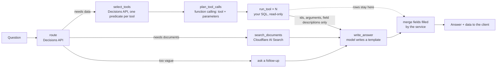

# business-qa-agent

Ask a question in plain language and get an answer drawn from your **business database** and your **business documents**, with every step streamed back as it happens.

The database side runs **only SQL you write**, as named tools. **Query results never go to the AI model provider.** The model writes the answer with merge fields, and the service fills in the real values before anything is sent to the client.

```
"Who owes us the most, how much is overdue, and what are our payment terms?"

  ● Working out what the question needs   purpose: data_and_documents · database ✓ · documents ✓
  ● Choosing database tools               top_unpaid_customers (0.92), overdue_invoices (0.71) of 6 tools
  ● Searching business documents          1 passage from policies/billing-terms.pdf
  ● Filling in tool parameters            top_unpaid_customers(limit=3) · overdue_invoices(as_of=2026-10-25)
  ● Running top_unpaid_customers          3 rows — values stay on the server
  ● Running overdue_invoices              2 rows — values stay on the server
  ● Writing the answer                    5 merge fields filled

  The model wrote:   **{{top_unpaid_customers.customer_name}}** owes the most: {{top_unpaid_customers.balance}}. …
  The client gets:   **Zephyr Holdings** owes the most: $98,765.43. …
```

## How it works



1. **Route.** One call to OpenAI's [Decisions API](https://developers.openai.com/api/docs/guides/decisions) (`gpt-6-luna`) answers four questions at once: the question's purpose, and whether it needs the database, needs documents, or is too vague.
2. **Choose tools.** A second Decisions call asks, for every tool you defined, "would this tool return data the question needs?". Tools above the threshold (at most 8) go forward, so the model only ever sees a short, relevant list.
3. **Fill in parameters.** A Responses API call with **function calling** picks which of those tools to call (possibly the same one twice, e.g. to compare periods) and fills in their parameters. The model sees each tool's name, description and parameters, **never its SQL**. Arguments are validated (types, required, enums, ranges, real dates), with one retry on mistakes.
4. **Run your SQL** with the arguments bound as parameters, read-only, with a timeout and a row cap. Calls run in parallel.
5. **Search documents** in [Cloudflare AI Search](https://developers.cloudflare.com/ai-search/) (formerly AutoRAG), in parallel with the database branch.
6. **Write the answer.** The model gets each call's id, the arguments it ran with, and the output fields' names and descriptions, **but not the rows**. It writes merge fields where values belong. Document passages are included as text and cited `[D1]`.
7. **Merge.** The service fills in the merge fields as the answer streams, so the client never sees a raw `{{…}}`. The response also carries the rows themselves (`data`) and the unfilled template (`answerTemplate`).

More in [docs/ARCHITECTURE.md](docs/ARCHITECTURE.md). Other tools worth adding are in [docs/TOOLS.md](docs/TOOLS.md).

## Quick start

Requires **Node 22.18+** (it runs the TypeScript directly; there's no build step).

```bash
npm install
cp .env.example .env          # OPENAI_API_KEY, connection strings, Cloudflare settings
cp tools.example.json tools.json   # then write your own tools
npm run tools:check -- --run  # validate tools.json and run each tool's example (read-only)
npm start                     # http://127.0.0.1:8787
```

Open `http://127.0.0.1:8787` for a small page that streams the steps, or call the API directly (below).

## Defining tools

`tools.json` has your database connections (`sources`) and your `tools`. A tool is one parameterized SELECT with a name and description the agent chooses by:

```json
{
  "name": "top_unpaid_customers",
  "description": "Customers with the largest unpaid invoice balances. Use for who owes the most, accounts receivable or collections questions.",
  "source": "sales",
  "parameters": [
    { "name": "limit", "type": "integer", "description": "How many customers to return.", "required": false, "default": 5, "minimum": 1, "maximum": 50 },
    { "name": "region", "type": "string", "description": "Only this sales region.", "required": false, "enum": ["North", "South", "Metro"] }
  ],
  "sql": "SELECT customer_name, SUM(total_amount - amount_paid) AS balance, COUNT(*) AS open_invoices FROM reporting.v_invoices WHERE status NOT IN ('paid','void') AND (:region IS NULL OR region = :region) GROUP BY customer_name ORDER BY balance DESC LIMIT :limit",
  "output": [
    { "name": "customer_name", "description": "Customer's business name.", "label": "Customer" },
    { "name": "balance", "description": "Unpaid balance across open invoices.", "format": "currency", "label": "Unpaid balance" },
    { "name": "open_invoices", "description": "Invoices not fully paid.", "format": "integer" }
  ],
  "resultDescription": "One row per customer with an unpaid balance, largest balance first.",
  "example": { "limit": 5, "region": null }
}
```

| Field | What it's for |
|---|---|
| `name` | snake_case. What the model calls, and the start of every merge field (`{{top_unpaid_customers.balance}}`). |
| `description` | **The most important field.** Tool selection reads it, so say which questions the tool answers. |
| `parameters` | `string`, `number`, `integer`, `boolean`, `date` or `datetime`, with optional `required: false`, `default`, `enum`, `minimum`, `maximum`, `maxLength`. Optional parameters arrive as `null` (or `default`), so write `(:region IS NULL OR region = :region)`. |
| `sql` | One `SELECT` or `WITH … SELECT` using `:name` placeholders. Every placeholder must be declared and every declared parameter used. Put your `ORDER BY` here; the service only caps the row count. |
| `output` | Every column the SQL returns that the answer may use (name them with `AS`). `format` is one of `text`, `number`, `integer`, `currency`, `percent` (a ratio: 0.125 → 12.5%), `date`, `month`, `datetime`, `boolean`. `label` is the table heading. |
| `resultDescription` | What the rows are and **how they're ordered**. The model can only say "the largest" or "the latest" when this tells it the order. |
| `maxRows` | Per-tool row cap (the global `MAX_ROWS` still applies). |
| `example` | Arguments `npm run tools:check -- --run` uses to test the tool. |

Placeholders become `($1::type)` on Postgres (the cast lets NULLs and reused parameters work) and `@p_name` on SQL Server. Values are always bound, never pasted into SQL. Use a **read-only database user** that can only `SELECT` the views your tools use.

## Merge fields

| Field | Fills in | Example |
|---|---|---|
| `{{call.field}}` | The field in the first row | `{{top_unpaid_customers.customer_name}}` |
| `{{call[n].field}}` | The field in row *n* (from 1) | `{{top_unpaid_customers[2].balance}}` |
| `{{table call}}` | Every row as a markdown table, using labels and formats | `{{table revenue_by_month}}` |
| `{{count call}}` | Number of rows (`200+` when cut off) | `{{count overdue_invoices}}` |
| `{{list call.field}}` | Every value, as "A, B, and C" | `{{list overdue_invoices.invoice_number}}` |
| `{{sum\|avg\|min\|max call.field}}` | Computed over all rows | `{{sum revenue_by_month.revenue}}` |

The call id is the tool name; a second call to the same tool is `tool_2`, then `tool_3`. Values are formatted with `LOCALE`, `CURRENCY` and `TIMEZONE`. Empty results fill in as `—` (or "No matching records" for tables). Failed calls and unknown references fill in as `[unavailable]` and are listed in `merge.unresolved`. When a result hit the row cap, a note is added to the answer.

**What this trades away:** the model can't see the numbers, so it can't say "revenue grew 12%" or pick out an outlier on its own. Its instructions tell it to present values and let the reader compare. Where you want a computed fact, put it in the SQL (a `growth_pct` column, an `ORDER BY` plus `resultDescription`) or use `sum`/`avg`/`min`/`max`.

## API

All `/ask` routes need `Authorization: Bearer <API_TOKEN>` when `API_TOKEN` is set. The server refuses to start on a non-loopback `HOST` without one.

### `POST /ask` — wait for the whole answer

```bash
curl -s localhost:8787/ask -H "Authorization: Bearer $API_TOKEN" -H 'Content-Type: application/json' \
  -d '{"question":"Who owes us the most?"}'
```

```json
{
  "runId": "…",
  "answer": "**Zephyr Holdings** owes the most: $98,765.43. …",
  "answerTemplate": "**{{top_unpaid_customers.customer_name}}** owes the most: {{top_unpaid_customers.balance}}. …",
  "citations": [{ "id": "top_unpaid_customers", "kind": "data", "source": "top_unpaid_customers", "detail": "limit = 3, region = not set" }],
  "data": [{ "id": "top_unpaid_customers", "tool": "top_unpaid_customers", "arguments": { "limit": 3, "region": null },
             "status": "ok", "error": null, "fields": ["…"], "rows": [{ "customer_name": "Zephyr Holdings", "balance": "98765.43", "open_invoices": "3" }],
             "rowCount": 3, "truncated": false }],
  "merge": { "fields": 5, "unresolved": [], "usedCalls": ["top_unpaid_customers"], "emptyCalls": [], "truncatedCalls": [] },
  "events": ["…every step event…"]
}
```

### `POST /ask/stream` — server-sent events

Same request; the response is `text/event-stream` with one event per step as it happens, plus `answer.delta` events carrying answer text **with merge fields already filled in**. The final `run.completed` event has the same fields as `POST /ask` and its `answer` is authoritative (tidier spacing than the concatenated deltas).

### `GET /ws` — WebSocket

```js
const ws = new WebSocket('ws://127.0.0.1:8787/ws');
ws.onopen = () => ws.send(JSON.stringify({ type: 'auth', token: API_TOKEN })); // skip if no API_TOKEN
ws.onmessage = (m) => {
  const msg = JSON.parse(m.data);
  if (msg.type === 'ready') ws.send(JSON.stringify({ type: 'ask', question: 'How many urgent tickets are open?', requestId: 'q1' }));
  else console.log(msg.type, msg); // every agent event, tagged with requestId
};
// ws.send(JSON.stringify({ type: 'cancel' })) stops the current question.
```

One question at a time per connection; open more connections for parallel questions.

### Events

| Event | When | Key fields |
|---|---|---|
| `run.started` | Question accepted | `runId`, `question` |
| `step.started` / `step.completed` | A step begins / ends | `step`, `key` (e.g. `run_tool:revenue_by_month`), `label`, `durationMs`, `data` |
| `step.skipped` | A tool wasn't needed or isn't configured | `step`, `reason` |
| `step.failed` | A step errored (the run may continue) | `step`, `key`, `error` |
| `answer.delta` | A piece of the answer, values filled in | `text` |
| `run.completed` | Done | `answer`, `answerTemplate`, `citations`, `data`, `merge`, `durationMs` |
| `run.failed` | The run couldn't finish | `error` |

Steps: `route`, `select_tools`, `plan_tool_calls`, `run_tool` (one per call), `search_documents`, `write_answer`. When a question is too vague, the tools are skipped and `write_answer` streams a follow-up question instead (its `data.mode` is `clarify`).

## Configuration

Everything is an environment variable; see [.env.example](.env.example) for the full list. The main ones:

| Variable | Default | Purpose |
|---|---|---|
| `OPENAI_API_KEY` | — | Required |
| `OPENAI_DECISION_MODEL` | `gpt-6-luna` | Decisions API model (routing, tool selection) |
| `OPENAI_MODEL` | `gpt-6-astra` | Responses API model (tool parameters, answer) |
| `TOOLS_PATH` | `tools.json` | Your database tools; the database route is off if the file is missing |
| `TOOL_SELECT_THRESHOLD` | `0.5` | Decisions probability needed to offer a tool to the model |
| `MAX_TOOL_CALLS` | `4` | Most tool calls per question (1–8) |
| `MAX_ROWS` / `QUERY_TIMEOUT_MS` | `200` / `10000` | Row cap and per-query timeout |
| `LOCALE` / `CURRENCY` / `TIMEZONE` | `en-US` / `USD` / `America/Chicago` | Merge-field formatting; `TIMEZONE` also resolves "this month" |
| `SHOW_SQL` | `true` | Include each call's SQL and parameters in step events (to the client only) |
| `CF_AI_SEARCH_INSTANCE` | — | Turns document search on |
| `API_TOKEN` | — | Bearer token; required off loopback |

## What goes to the model provider

| Sent to OpenAI | Never sent |
|---|---|
| The question, today's date | Database rows, or anything computed from them |
| Tool names, descriptions and parameter definitions | Your SQL |
| The arguments the model itself chose | Database error messages |
| Output field names, formats and descriptions; `resultDescription` | Connection strings |
| Document passages from AI Search (the document route needs them) | |

An automated test runs a full question and checks that no row value appears in any request to the model, and the end-to-end check did the same against the running server. Responses API calls also send `store: false`.

## Security notes

- **Only your SQL runs.** The model chooses tools and parameter values; values are always bound parameters; each tool's SQL is checked to be one `SELECT` when `tools.json` loads.
- **Read-only, twice.** Postgres queries run in `BEGIN READ ONLY` with a `statement_timeout` and are rolled back. For both engines, use a database user that can only read the views your tools use.
- **Access.** Bearer token with a constant-time check; request bodies capped at 16 KB; questions at 2,000 characters.
- **Merged values are inserted as plain text.** If a client renders the answer as HTML, escape it first (the demo page builds DOM text nodes).
- Tools limit *what can be queried*, not *who may see it*. If different users should see different rows, enforce it in the database (row-level security or per-user views).

## Development

```bash
npm test               # node:test, no network
npm run typecheck      # tsc --noEmit
npm run tools:check    # validate tools.json; add -- --run to execute the examples
npm run dev            # restart on file changes
```

Tests cover tool definitions, named-parameter binding for both engines, argument validation, merge fields and the streaming merger, the OpenAI and AI Search clients (mocked HTTP), routing, full agent runs including the no-data-to-the-model check, and the HTTP, SSE and WebSocket transports.

## Status and limits

Updated 2026-10-25.

- **Verified:** 71 tests pass; the example tools' SQL run against a real PostgreSQL 16 with sample data (NULL optional parameters, `LIMIT :limit`, date arithmetic, an injection attempt returning no rows); the full server run end to end against mock OpenAI and Cloudflare endpoints with no row values in any provider request; the demo page in a headless browser.
- **Not yet verified live:** real OpenAI and Cloudflare calls (request shapes follow their October 2026 docs; the Decisions API is new, so check its current status and fields), the `pg` and `mssql` drivers themselves, and the SQL Server tools on a real server.
- **No conversation memory yet:** each question stands alone.
