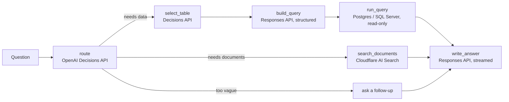

# business-qa-agent

Ask a question in plain language and get an answer drawn from your **business database** and your **business documents**, with every step streamed back as it happens.

```
"Which customers owe us the most, and what are our payment terms?"

  ● Working out what the question needs     purpose: data_and_documents · database ✓ · documents ✓
  ● Choosing a table or view                sales.v_invoices (confidence 0.88)
  ● Searching business documents            1 passage from policies/billing-terms.pdf
  ● Planning a query on sales.v_invoices    SELECT … WHERE "status" NOT IN ($1, $2) … LIMIT 4
  ● Running the query on sales              3 rows, truncated
  ● Writing the answer                      Lakeside Dental owes the most: $900.00 [T1] …
```

## How it works



1. **Route.** One call to OpenAI's [Decisions API](https://developers.openai.com/api/docs/guides/decisions) (`gpt-6-luna`) answers four questions at once: the question's purpose (a choice), and whether it needs the database, needs documents, or is too ambiguous to answer (three probabilities).
2. **Pick the table or view.** A second Decisions call chooses among the tables and views in your catalog, using the descriptions you wrote, with a "none of these" option.
3. **Plan the query.** A Responses API call with Structured Outputs fills in a query plan whose JSON Schema only allows that table's columns and metrics. **The model never writes SQL.** The plan is validated (one retry with the exact problems if it's wrong) and compiled to parameterized SQL for Postgres or SQL Server.
4. **Run it** read-only, with a timeout and a row cap.
5. **Search documents** in [Cloudflare AI Search](https://developers.cloudflare.com/ai-search/) (formerly AutoRAG), in parallel with the database branch.
6. **Write the answer** from the rows and passages, streamed token by token, with `[T1]` / `[D1]` citations.

A failing tool doesn't fail the run: its step reports the error and the answer says what's missing. More detail in [docs/ARCHITECTURE.md](docs/ARCHITECTURE.md); other tools worth adding are in [docs/TOOLS.md](docs/TOOLS.md).

## Quick start

Requires **Node 22.18+** (it runs the TypeScript directly; there's no build step).

```bash
npm install
cp .env.example .env            # add OPENAI_API_KEY, connection strings, Cloudflare settings
cp catalog.example.json catalog.json   # then describe your own tables/views
npm start                       # http://127.0.0.1:8787
```

Open `http://127.0.0.1:8787` for a small page that streams the steps, or call the API directly (below).

### Write the catalog

The catalog is the agent's whole view of your database: only what's listed can be queried. It's also what makes answers accurate, since the models choose tables and columns from your descriptions.

```bash
# Draft one from information_schema, then fill in the TODOs:
npm run catalog:draft -- --source sales --engine postgres --env SALES_DATABASE_URL --schema reporting > catalog.draft.json
```

Tips:

- **Point it at views, not raw tables.** A view per question area (`v_invoices`, `v_tickets`) hides joins, renames cryptic columns and leaves out sensitive ones. The agent queries one table or view per question.
- **Describe what one row is** ("One row per invoice…"). This matters more than anything else for table selection.
- **Add `metrics`** for business calculations that must always be computed the same way (revenue, outstanding balance). The model can only pick a metric by name; the SQL is yours.
- **Add a few `sampleValues`** to text columns so filters match how data is stored ("partially_paid", not "partly paid"). Leave them off sensitive columns.
- Use a **read-only database user** that can only `SELECT` the catalog's views.

### Set up AI Search

Create an AI Search instance in the Cloudflare dashboard over your R2 bucket (or website), then set `CF_ACCOUNT_ID`, `CF_API_TOKEN` (AI Search Run permission) and `CF_AI_SEARCH_INSTANCE`. The agent uses the retrieval-only `/search` endpoint and writes one combined answer itself.

## API

All `/ask` routes need `Authorization: Bearer <API_TOKEN>` when `API_TOKEN` is set. The server refuses to start on a non-loopback `HOST` without one.

### `POST /ask` — wait for the whole answer

```bash
curl -s localhost:8787/ask -H "Authorization: Bearer $API_TOKEN" -H 'Content-Type: application/json' \
  -d '{"question":"What was revenue by month this year?"}'
```

```json
{ "runId": "…", "answer": "…", "citations": [{ "id": "T1", "kind": "table", "source": "sales.v_invoices", "detail": "…" }],
  "events": [ { "type": "run.started" }, { "type": "step.started", "step": "route" }, "…" ] }
```

### `POST /ask/stream` — server-sent events

Same request; the response is `text/event-stream` with one event per step as it happens, plus `answer.delta` for each piece of the answer.

```
event: step.completed
data: {"type":"step.completed","step":"select_table","data":{"table":"sales.v_invoices","confidence":0.88,…},…}

event: answer.delta
data: {"type":"answer.delta","text":"Revenue in January was "}
```

### `GET /ws` — WebSocket

```js
const ws = new WebSocket('ws://127.0.0.1:8787/ws');
ws.onopen = () => ws.send(JSON.stringify({ type: 'auth', token: API_TOKEN })); // skip if no API_TOKEN
ws.onmessage = (m) => {
  const msg = JSON.parse(m.data);
  if (msg.type === 'ready') ws.send(JSON.stringify({ type: 'ask', question: 'How many urgent tickets are open?', requestId: 'q1' }));
  else console.log(msg.type, msg); // every agent event, tagged with requestId
};
// ws.send(JSON.stringify({ type: 'cancel' })) stops the current question.
```

One question at a time per connection; open more connections for parallel questions.

### Events

| Event | When | Key fields |
|---|---|---|
| `run.started` | Question accepted | `runId`, `question` |
| `step.started` | A step begins | `step`, `label` |
| `step.completed` | A step finished | `step`, `durationMs`, `data` (step-specific: purpose and probabilities, chosen table and confidence, plan explanation and SQL, row count, document sources) |
| `step.skipped` | A tool wasn't needed or isn't configured | `step`, `reason` |
| `step.failed` | A step errored (the run may continue) | `step`, `error` |
| `answer.delta` | A piece of the answer | `text` |
| `run.completed` | Done | `answer`, `citations`, `durationMs` |
| `run.failed` | The run couldn't finish | `error` |

Steps: `route`, `select_table`, `build_query`, `run_query`, `search_documents`, `write_answer`. When a question is too vague, the tools are skipped and `write_answer` streams a follow-up question instead (its `data.mode` is `clarify`).

## Configuration

Everything is an environment variable; see [.env.example](.env.example) for the full list with comments. The main ones:

| Variable | Default | Purpose |
|---|---|---|
| `OPENAI_API_KEY` | — | Required |
| `OPENAI_DECISION_MODEL` | `gpt-6-luna` | Decisions API model (routing, table choice) |
| `OPENAI_MODEL` | `gpt-6-astra` | Responses API model (query plan, answer) |
| `CATALOG_PATH` | `catalog.json` | Tables/views the agent may use; database is off if the file is missing |
| `MAX_ROWS` / `QUERY_TIMEOUT_MS` | `200` / `10000` | Row cap and per-query timeout |
| `SHOW_SQL` | `true` | Include SQL and parameters in step events |
| `CF_AI_SEARCH_INSTANCE` | — | Turns document search on |
| `API_TOKEN` | — | Bearer token; required off loopback |
| `TIMEZONE` | `America/Chicago` | Resolves "this month", "last quarter" |

## Security notes

- **No model-written SQL.** Identifiers come only from the catalog and are quoted; every value is a bound parameter; the only statement produced is one `SELECT` with a row cap. Metric SQL is written by you.
- **Read-only, twice.** Postgres queries run in `BEGIN READ ONLY` with a `statement_timeout` and are rolled back. For both engines, use a database user that can only read the catalog's views.
- **Least data out.** Responses API calls send `store: false`. Rows sent to the model are capped (`MAX_ROWS`) and long cells are clipped. Set `SHOW_SQL=false` if clients shouldn't see SQL.
- **Access.** Bearer token with a constant-time check; request bodies capped at 16 KB; questions at 2,000 characters.
- The catalog limits *what can be queried*, not *who may see it*. If different users should see different rows, enforce it in the database (row-level security or per-user views), not in prompts.

## Development

```bash
npm test          # node:test, no network
npm run typecheck # tsc --noEmit
npm run dev       # restart on file changes
```

Tests cover the catalog validator, the query-plan schema and validator, both SQL dialects, the OpenAI and AI Search clients (with mocked HTTP), routing, the full agent run (with a fake model), and the HTTP, SSE and WebSocket transports.

## Status and limits

Built and tested on 2026-10-24.

- **Verified:** unit and transport tests; compiled Postgres SQL run against a real PostgreSQL 16 with sample data (correct totals, truncation, LIKE escaping, week buckets); the full server run end to end against mock OpenAI and Cloudflare endpoints; the demo page in a headless browser.
- **Not yet verified live:** real OpenAI and Cloudflare calls (request shapes follow their October 2026 docs; the Decisions API is new, so check its current status and fields), the `pg` and `mssql` drivers themselves, and the SQL Server dialect on a real server.
- **One table or view per question.** Questions that need joins work best through a view you define. Multi-table planning is a listed next step in [docs/TOOLS.md](docs/TOOLS.md).
- **No conversation memory yet:** each question stands alone.
- Third-party guides report a 255-choice limit per Decisions question, so table selection is capped at 254 tables/views per catalog (one choice is "none").
